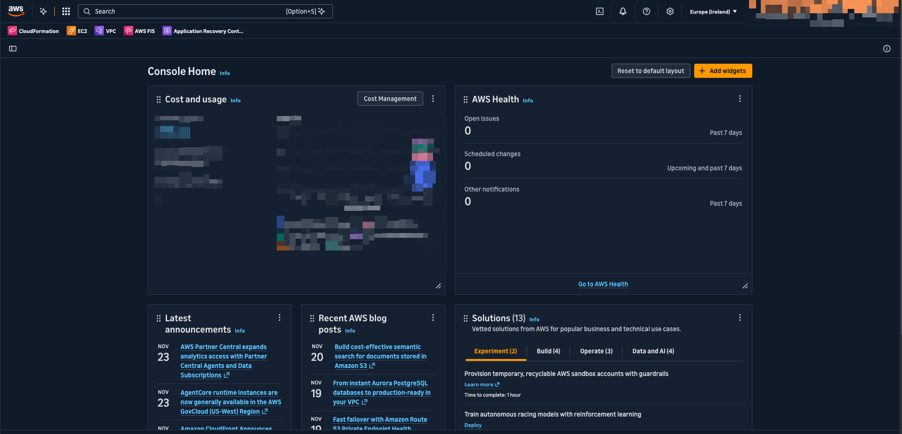
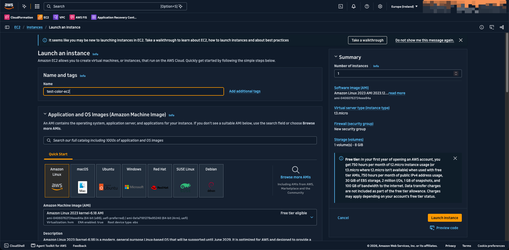
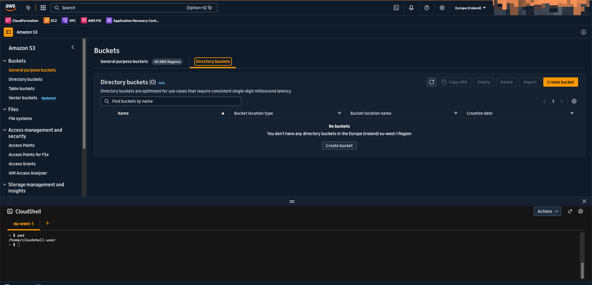
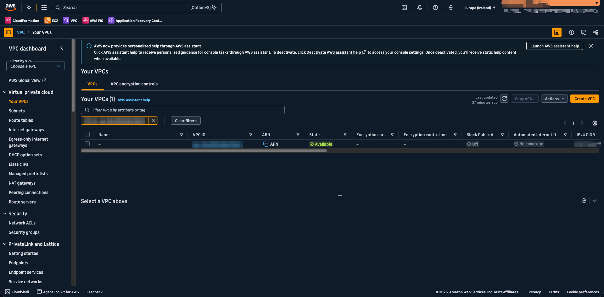

# AWS Console – Classic Dark

A theme for the AWS Management Console.
It brings back the look of the **classic AWS dark mode**:

- Dark navy blue background
- Cool grey text
- **AWS orange** highlights (main button, active tab, checkboxes...)

| EC2 – Launch an instance | S3 – Buckets and CloudShell |
|---|---|
|  |  |
| **VPC – Your VPCs** | |
|  | |

It is built on top of the theme
[aws-console-ui-theme-ayu-dark](https://github.com/igreg/aws-console-ui-theme-ayu-dark)
by [igreg](https://github.com/igreg) (Gregory Becker, MIT licence). That theme does the hard part: it lists the console's internal colour tokens.
This project keeps that list and only swaps the colours.

## What you need

- A browser with the **Stylus** extension: Chrome, Firefox, Edge, Brave, Vivaldi, Arc or Opera.
  Safari is not supported (there is no Stylus for Safari).
- The AWS console in dark mode: click the **gear icon** in the top bar → **Visual mode** → **Dark**.

## How to install

1. Install the **Stylus** extension in your browser:

   | Browser | Where to get Stylus |
   |---|---|
   | Chrome | [Chrome Web Store](https://chromewebstore.google.com/detail/stylus/clngdbkpkpeebahjckkjfobafhncgmne) |
   | Firefox | [Firefox Add-ons](https://addons.mozilla.org/firefox/addon/styl-us/) |
   | Edge | [Edge Add-ons](https://microsoftedge.microsoft.com/addons/detail/stylus/ffljdddodmkedhkcjhpmdajhjdbkogke) |
   | Brave, Vivaldi, Arc | [Chrome Web Store](https://chromewebstore.google.com/detail/stylus/clngdbkpkpeebahjckkjfobafhncgmne) (these browsers use Chrome extensions) |
   | Opera | [Chrome Web Store](https://chromewebstore.google.com/detail/stylus/clngdbkpkpeebahjckkjfobafhncgmne). The version in the Opera add-ons store is old. To install from the Chrome Web Store, first add Opera's **Install Chrome Extensions** add-on. |

2. Open this link:
   https://raw.githubusercontent.com/pdelaroche/aws-console-classic-dark/main/aws-classic-dark.user.css
3. Stylus opens an install page. Click **Install style**.
4. Open the AWS console and reload the page (Cmd+Shift+R or Ctrl+Shift+R).

That's all. Stylus checks this link for new versions.

## How to change the colours

All the colours are in one block called **PALETTE**.

**Option A – in the browser (easy)**

1. Open Stylus → **Manage** → **AWS Console - Classic Dark** → **Edit**.
2. The PALETTE block is at the top. Change the colours you want.
3. Click **Save** and reload AWS.

Note: if you edit the style in Stylus, an update can replace your changes.
Turn off updates for this style if you want to keep them.

**Option B – in the project (for developers)**

1. Edit `palette.css`.
2. Run `python3 build.py`.
3. The script makes a new `aws-classic-dark.user.css`.
4. To publish an update, change `VERSION` in `build.py` before you run it.
   Stylus only finds updates when the version number changes.

| Variable | What it colours |
|---|---|
| `--tpl-bg` | Main background and top bar |
| `--tpl-panel` | Cards, panels and code blocks |
| `--tpl-surface`, `--tpl-surface-2` | Menus and dropdowns |
| `--tpl-hover` | Background when the mouse is over an item |
| `--tpl-border-*` | Borders and lines |
| `--tpl-text-*` | Text, from dark to light |
| `--tpl-heading` | Titles |
| `--tpl-accent` | Highlights: main button, active tab, checkboxes... |
| `--tpl-accent-hover` / `--tpl-accent-active` | Highlight on mouse over / on click |
| `--tpl-on-accent` | Text and icons on orange (main button, checkboxes) |
| `--tpl-link` / `--tpl-link-hover` | Links and blue info elements |
| `--tpl-selection` | Background of selected text |
| `--tpl-nav-title` | Titles in the side menu |

Two see-through versions of the highlight colour (`--tpl-accent-soft`, `--tpl-accent-softer`)
are made automatically from `--tpl-accent`. Do not add them to the PALETTE block.

Status colours (green, red, yellow) and badge colours come from the base theme,
so they are Ayu colours, not the classic AWS ones. This project does not change them.

## Change the colours with AI

1. Open `prompt-ai.md`.
2. Write the style you want, for example "dark green, like a terminal".
3. Paste the prompt and your PALETTE block into any AI chat.
4. Replace your PALETTE block with the new one.

## Project files

| File | What it is |
|---|---|
| `aws-classic-dark.user.css` | The theme. This is the file you install. |
| `palette.css` | The colours |
| `build.py` | Makes the theme from the base theme and the palette |
| `base/` | The original Ayu Dark theme and its licence |
| `prompt-ai.md` | A prompt to make new colours with AI |
| `screenshots/` | Preview images for this README |

## Problems and fixes

| Problem | Possible cause | Fix |
|---|---|---|
| Nothing changes after install | Browser cache | Reload with Cmd+Shift+R |
| Nothing changes after reload | The console is in light mode | Gear icon → Visual mode → Dark |
| One AWS service (or part of a page) is still grey | That service uses colour tokens the base theme does not know yet | Get the newest `aws-console.ayu-dark-theme.css` from the [base theme](https://github.com/igreg/aws-console-ui-theme-ayu-dark), put it in `base/`, run `python3 build.py` |
| Nothing changes on the China console | The theme only matches `console.aws.amazon.com` | Not supported (`console.amazonaws.cn` is a different domain) |

## How to remove it

Stylus → **Manage** → untick the style, or delete it.

## Security

- **It is only CSS.** The theme only changes colours. It has no JavaScript,
  no `url()` and no `@import`. It does not load anything from other sites
  and it does not send any data.
- **It cannot touch your AWS account.** It cannot call AWS, read your
  credentials or change your resources. If you turn it off, the console is
  exactly as before.
- **Updates come from this repo.** Stylus downloads new versions from the
  `main` branch. If you do not want this, turn off updates for this style in
  Stylus. You can also read the file before you install a new version.
- **The extension has wide access.** Like any style extension, Stylus can
  read and change every website. Install it only from the official stores
  (links above).
- **At work:** many companies do not allow browser extensions on the browser
  you use for production accounts. Ask your security team first.

## Credits

- Base theme: [igreg](https://github.com/igreg) (Gregory Becker), MIT licence (see `base/LICENSE`).
- Classic Dark colours: based on the classic Cloudscape dark palette (approximate values).
- Unofficial project. It is not connected to Amazon Web Services.
